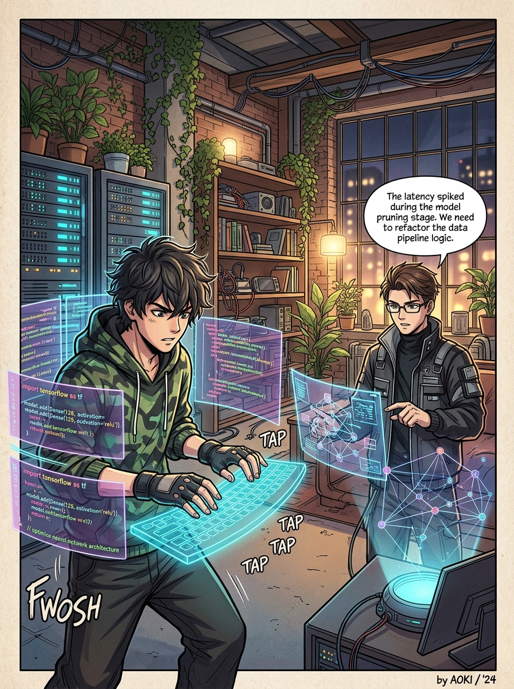



  

  
  
  
  
  

  

---

## 👨‍💻 Обо мне

<table>
  <tr>
    <td width="38%" align="center" valign="top">
      
       
      <i>⚡ Kema · Backend, Desktop & Cross-Platform Dev</i>
    </td>
    <td width="62%" valign="top">
      <h3>Привет, я Кемран 👋</h3>
      

        Мне 18 лет, учусь на 2-м курсе <b>ИЦТ СКГА</b> (Институт цифровых технологий) по направлению программной инженерии.
      

      

        Проектирую и создаю независимые программные экосистемы «с нуля»: от высоконагруженных асинхронных бэкендов и сквозного E2E-шифрования до кроссплатформенных мобильных клиентов на <b>Flutter</b>, реактивных терминальных утилит на <b>Go</b> и десктопных приложений на <b>C++</b> и <b>Python</b>.
      

      <ul>
        <li>🚀 <b>Специализация:</b> Highload Backend, Cross-Platform UI (Flutter), Desktop GUI, TUI, Network Security.</li>
        <li>🛡️ <b>Фокус:</b> Приватность, криптография (Zero-Knowledge, Curve25519), чистая архитектура и высокая отзывчивость интерфейсов (60/120 FPS, Zero UI Freezes).</li>
        <li>🐧 <b>Окружение:</b> Самостоятельно администрирую Linux-сервера (Ubuntu, Caddy v2, Nginx, Docker, Systemd), в качестве основной рабочей станции использую связку CachyOS (Arch) + Hyprland и Windows 11.</li>
      </ul>
    </td>
  </tr>
</table>

---

## 🚀 Флагманские проекты

### 1. ⚡ [Connecto — Private Messenger](https://github.com/kemranbatcaev02-gif/Connecto---private-messenger)
> **Бескомпромиссно приватный, сверхбыстрый кроссплатформенный мессенджер нового поколения.**
- **Стек:** `Dart 3.x`, `Flutter 3.x` (Web, Android, Desktop), `FastAPI (Python 3.12)`, `WebSockets`, `WebRTC P2P`, `Curve25519 + AES-256-GCM`, `SQLite (WAL mode)`, `Caddy v2`.
- **Особенности:** Архитектура нулевого доверия (Zero-Knowledge), ключи шифрования только на клиентах, самоуничтожающиеся сообщения, HD аудио/видеозвонки WebRTC, внутренняя экономика кристаллов и 3D-подарков, Glassmorphism-дизайн.
- **Ссылки:** [📢 Официальный Telegram-канал](https://t.me/connecto_official) • [🌐 Web-версия (Beta)](https://connectomes.duckdns.org)

### 2. 🐳 [DockDash (Wharf) — Terminal Docker Management Suite](https://github.com/kemranbatcaev02-gif/dockdash)
> **Ультрабыстрый, отзывчивый терминальный дашборд (TUI) для мониторинга и управления Docker-контейнерами на Go.**
- **Стек:** `Go 1.27+`, `Bubble Tea (The Elm Architecture)`, `Lipgloss`, `Docker Official Engine SDK v27`, `stdcopy`.
- **Особенности:** Zero UI Freezes (все операции в горутинах), живой стриминг логов с автоскроллом и подсветкой синтаксиса, мониторинг CPU% и RAM с прогресс-барами `[■■■□□□]`, модальные окна подтверждения, встроенный автономный Demo-симулятор кластера (работает даже без Docker).

### 3. 🌸 Bloom — Social Network
> **Авторская социальная сеть нового поколения с упором на авторский контент и безопасность.**
- **Статус:** В активной разработке, проект готовится к защите на проектном акселераторе **Leader-ID**.

### 4. 🕹️ [Tetris Deluxe](https://github.com/kemranbatcaev02-gif/tetris-deluxe)
> **Современная аркадная реализация классической игры на C++17 и библиотеке SFML 3.**
- **Стек:** `C++17`, `SFML 3.0`, `CMake`, `MSYS2 UCRT64`.
- **Особенности:** RPG-прокачка игрока (XP, уровни), внутриигровая экономика монет, магазин 10 процедурных стилей блоков (Rainbow, Gold, Crystal, Neon, Cosmic), физика сотен частиц, кинематографичная тряска экрана, сохранение профиля в `profile.dat`.

### 5. 💻 [SystemMonitor](https://github.com/kemranbatcaev02-gif/SystemMonitor)
> **Десктопный монитор системных ресурсов на базе Python и PySide6 (Qt).**
- **Стек:** `Python`, `PySide6 (Qt6)`, `Custom QPainter`, `psutil`.
- **Особенности:** Векторные круговые гейджи (CPU, RAM, Disk), сглаженные графики скорости сети и нагрузки процессора с градиентной заливкой, топ процессов по потреблению ресурсов, темная тема QSS.

### 6. 🎯 [CS2 Stats & Tactics Hub](https://github.com/kemranbatcaev02-gif/cs2-stats-app)
> **Персональный аналитический центр для Counter-Strike 2: парсинг демок и справочник гранат.**
- **Стек:** `Python 3.12`, `CustomTkinter`, `Rust-движок demoparser2`, `SQLite 3`.
- **Особенности:** Локальный разбор файлов `.dem` на базе ядра Rust, автоподсчет K/D, ADR, Headshot %, персонализация по SteamID64, интерактивный иллюстрированный каталог раскидок гранат (смоки, флешки, молотовы) для турнирных карт.

### 7. 💪 [GymLog](https://github.com/kemranbatcaev02-gif/gymlog)
> **Автономный трекер силовых тренировок и аналитики спортивного прогресса.**
- **Стек:** `Python`, `CustomTkinter`, `Matplotlib`, `SQLite 3`.
- **Особенности:** Дневник подходов с коэффициентом усилия (RPE), база 40+ упражнений, расчет 1ПМ по формуле Эпли, наглядные графики роста рабочих весов и экспорт в CSV.

### 8. ⛏️ [Minecraft Craft Calculator](https://github.com/kemranbatcaev02-gif/craft-calculator)
> **Калькулятор сырья для крафтов в Minecraft с рекурсивным разбором дерева рецептов.**
- **Стек:** `Python`, `CustomTkinter`, `JSON Data Engine`.
- **Особенности:** 97 ванильных рецептов, расчет базового сырья с учетом партионности крафта, пошаговый порядок действий и интерактивное сворачиваемое дерево крафта.

### 9. 🐍 [PyLearn](https://github.com/kemranbatcaev02-gif/pylearn)
> **Интерактивный десктопный тренажер по программированию (Python & C++).**
- **Стек:** `Python 3.12`, `CustomTkinter`, `SQLite 3`, встроенный Runner.
- **Особенности:** Трехэтапный педагогический цикл: Лекция (Markdown) → Практика (написание кода со сверкой вывода в stdout) → Тест (MCQ, вопросы на вывод кода, True/False со скором $\ge 60\%$).

---

## 🛠 Технологический стек

  

| Категория | Технологии и инструменты |
| :--- | :--- |
| **Языки программирования** | **Go (Golang)** • **Python 3.10–3.12** • **Dart 3.x** • **C++17** • **C# (.NET)** • **Kotlin** • **SQL** • **HTML5 / CSS3 / JavaScript** |
| **Frontend & Мобильная разработка** | **Flutter 3.x** (Android, Web, Desktop) • **Jetpack Compose** • **HTML5/CSS3/Vanilla JS** • **PWA** |
| **Backend & Микросервисы** | **FastAPI** • **Uvicorn / Starlette** • **WebSockets** • **WebRTC P2P** • **Pydantic v2** • **SQLAlchemy ORM** • **Go Standard Library (net/http)** |
| **Desktop & TUI** | **Bubble Tea & Lipgloss (Go)** • **PySide6 / Qt6 (QPainter, QSS)** • **CustomTkinter** • **SFML 3.0** • **WPF** • **Matplotlib** |
| **Базы данных и кэширование** | **PostgreSQL** • **Redis** • **SQLite 3 (WAL mode, составные индексы)** |
| **Безопасность и криптография** | **End-to-End Encryption (E2EE)** • **Curve25519 (X25519)** • **AES-256-GCM** • **PBKDF2** • **Zero-Knowledge Architecture** |
| **DevOps, Серверы & Инфраструктура** | **Docker & Docker Compose** • **Linux (Ubuntu Server, Arch/CachyOS)** • **Caddy v2 (Auto-TLS HTTP/2 & HTTP/3)** • **Nginx** • **Systemd** • **Git & GitHub Actions** • **CMake** |

---

## 🎨 Творческая студия и инженерная лаборатория

  

### 🎯 Текущие цели и планы:
1. 🚀 **Connecto:** Открытие публичного доступа к веб-версии, релиз мобильного клиента в Google Play, RuStore и App Store.
2. 🏆 **Bloom:** Защита концепции и архитектуры на акселераторе проектов Leader-ID с последующим выходом в бета-тестирование.
3. 📦 **Open-Source:** Развитие экосистемы легковесных терминальных утилит на Go и высокопроизводительных модулей на C++.
4. 🖥️ **Hardware:** Апгрейд домашней серверной стойки и рабочей станции на платформе AM5.

---

## ⚙️ Мой сетап (Battle Station)

- **Ноутбук:** Gigabyte G5 KF (Intel Core i5-12500H, NVIDIA GeForce RTX 4060 Laptop 8GB, 16GB DDR4, 512GB NVMe SSD)
- **Клавиатура:** MCHOSE Ace 68 V2 (механическая, смазанные переключатели)
- **Мышь:** MCHOSE A5 V2 Ultra (легкая беспроводная, оптический сенсор PAW3395)
- **Наушники:** MCHOSE S9 Pro
- **Микрофон:** Ardor Gaming
- **Операционные системы:** 
  - 🐧 **CachyOS (Arch Linux) + Hyprland** — для быстрой и комфортной разработки, работы с Docker, Go и Python.
  - 🪟 **Windows 11 Pro** — для десктопного тестирования, C++ SFML и игр.

---

## 📈 Активность на GitHub

  <picture>
    <source media="(prefers-color-scheme: dark)" srcset="https://raw.githubusercontent.com/kemranbatcaev02-gif/kemranbatcaev02-gif/output/snake-dark.svg">
    <source media="(prefers-color-scheme: light)" srcset="https://raw.githubusercontent.com/kemranbatcaev02-gif/kemranbatcaev02-gif/output/snake-light.svg">
    
  </picture>

---

## 📬 Связаться со мной

  
  
  
  
   
  
  
  

  © 2026 Kemran (Kema). Спроектировано с любовью к качественному коду и эстетике.

